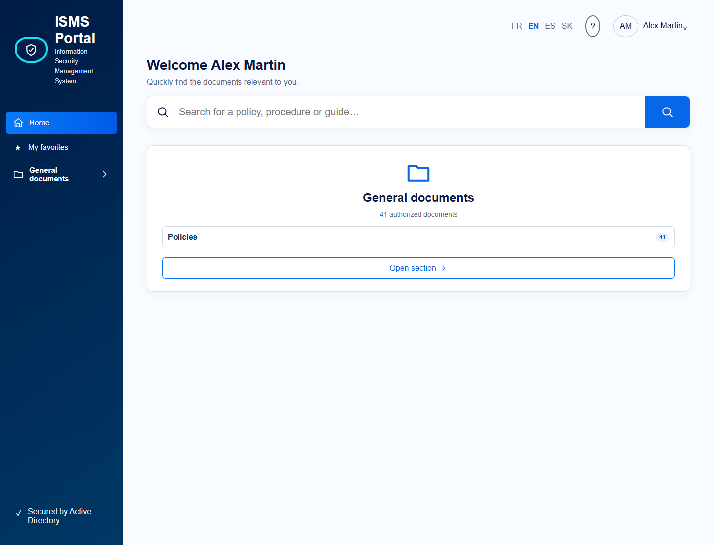
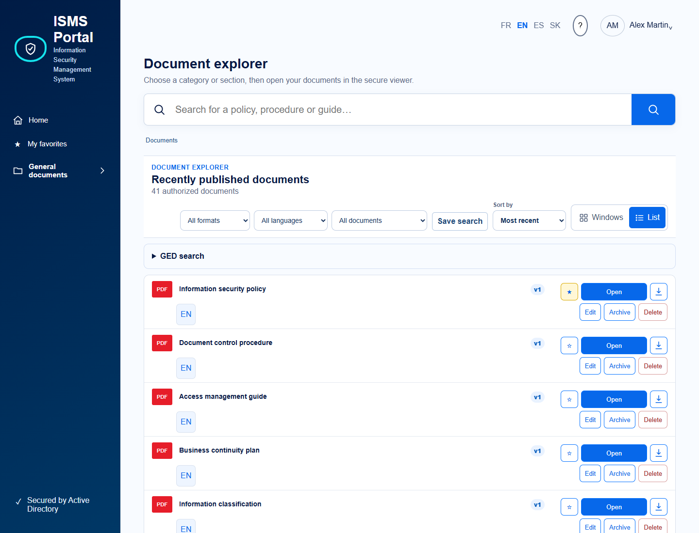
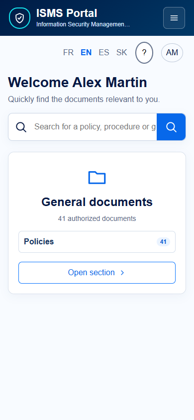
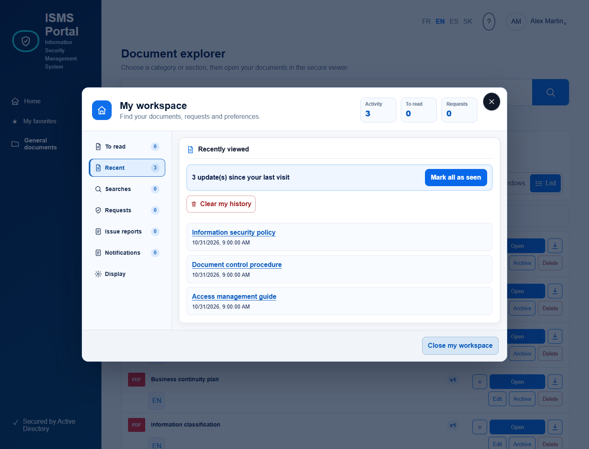
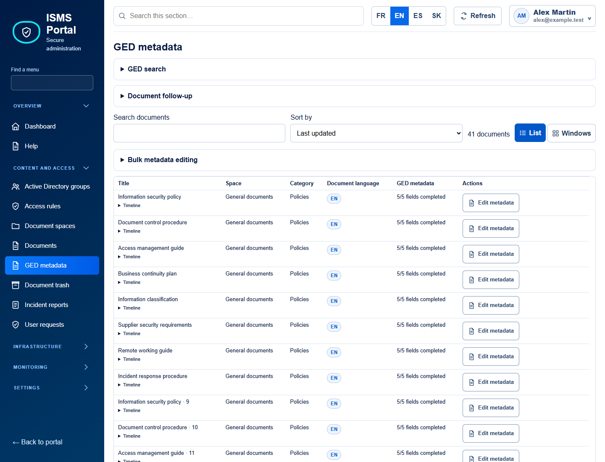
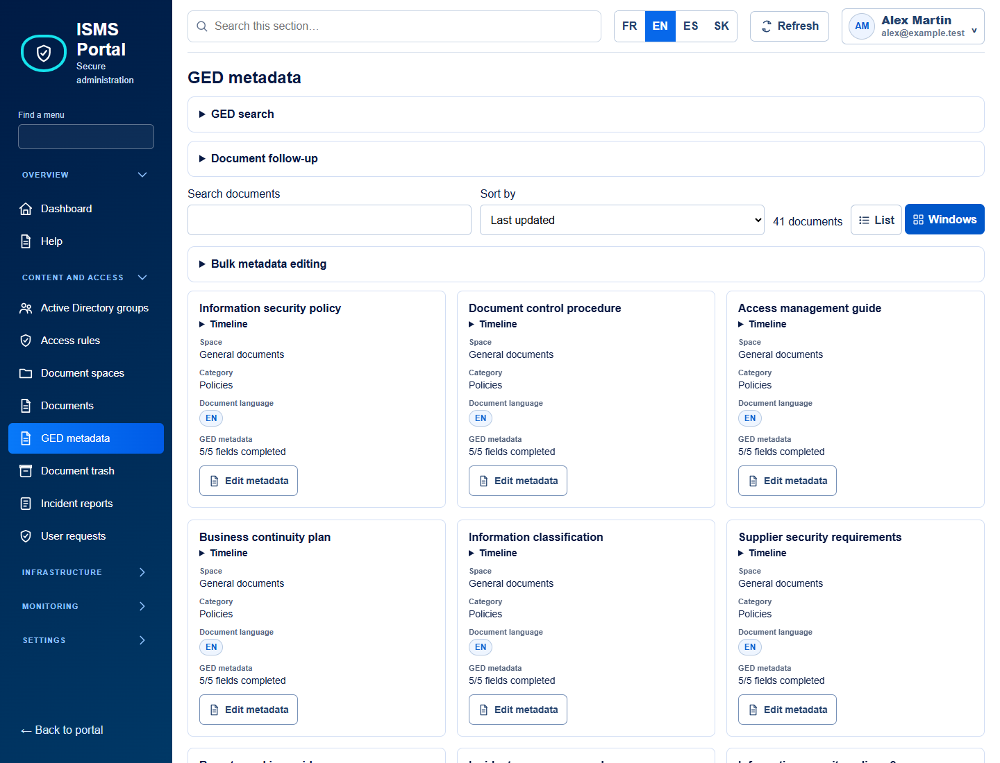
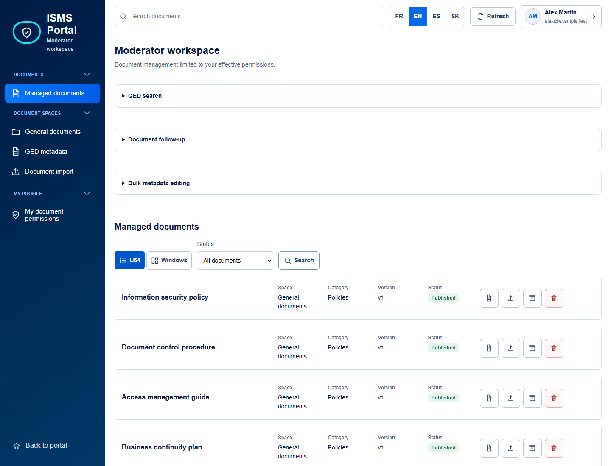
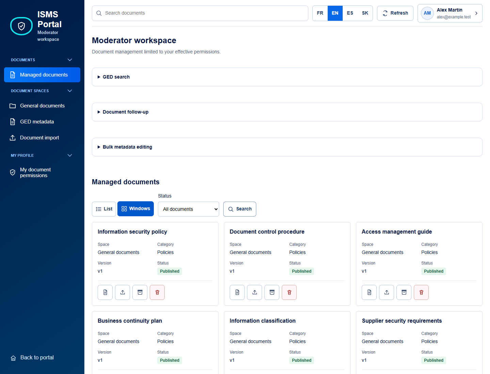
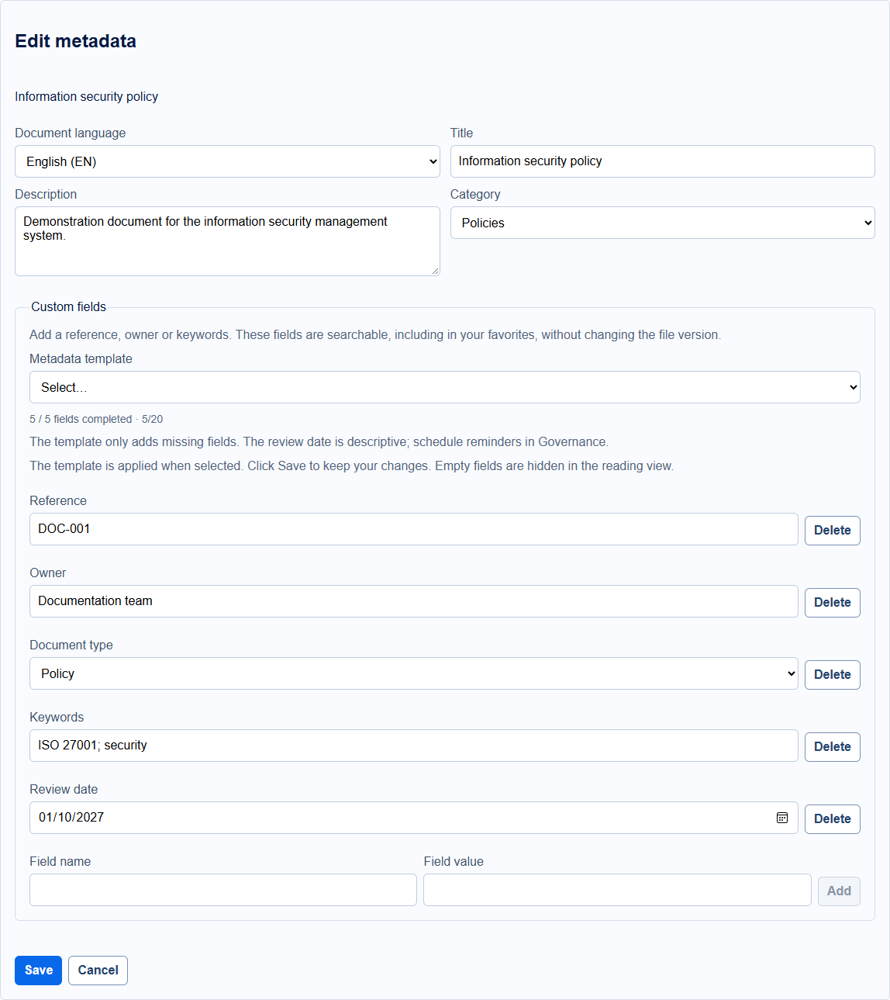

# ISMS Portal

Portail documentaire ISMS/ISO 27001 en français, anglais, espagnol et slovaque, protégé par les groupes Active
Directory. L’API applique un modèle _deny by default_ : espaces, recherche,
consultation, téléchargement et administration sont filtrés côté serveur.

## Licence et utilisation non commerciale

ISMS Portal est distribué sous la licence **PolyForm Noncommercial 1.0.0**.
Le texte intégral applicable est disponible dans [LICENSE.md](LICENSE.md).

- L'utilisation, la modification et la redistribution sont autorisées pour les
  finalités permises par cette licence, notamment les usages non commerciaux.
- L'exploitation commerciale (vente, offre SaaS payante, intégration à une offre
  commerciale ou prestation commerciale fondée sur le logiciel) n'est pas
  autorisée par cette licence. Elle nécessite une autorisation distincte des
  titulaires des droits.
- Un usage interne en entreprise n'est pas automatiquement non commercial :
  sa finalité doit respecter la licence. Pour une demande d'autorisation,
  contacter le propriétaire du dépôt, [aurelson101](https://github.com/aurelson101).
- Toute redistribution doit conserver la licence ou son URL ainsi que les
  mentions obligatoires prévues par celle-ci.
- Les dépendances et composants tiers restent soumis à leurs propres licences.
  Cette licence ne remplace pas leurs conditions.
- Le logiciel est fourni sans garantie, dans les limites prévues par la licence.

Il s'agit d'une licence à **code source disponible** (*source available*),
et non d'une licence open source au sens de l'OSI, puisque les usages commerciaux
sont restreints. Le résumé ci-dessus est informatif ; le texte de la licence
fait foi.

## Dernières nouveautés

### Préversion v0.9.63-rc.2 (31 octobre 2026)

- Menus **Métadonnées GED** dédiés aux administrateurs et modérateurs, avec
  l'éditeur partagé, la recherche, la pagination et les capacités par document.
- Correctif `qs` 6.16.1 et tests de compatibilité des archives intégrés à `npm test`.
- Point restant : `npm audit --omit=dev` signale sept entrées modérées transitives
  liées à l'[avis minimatch](https://github.com/advisories/GHSA-g3hv-75wg-m249)
  via l'ancien `glob`. La substitution majeure incompatible n'est pas appliquée ;
  cette préversion ne constitue pas une validation de sécurité exhaustive.

- **SSO sans groupe (option)** : limiter l'acces aux comptes internes actifs
  disposant d'une boite Exchange personnelle dans les domaines autorises.
  Les boites partagees et invites sont refuses ; les ACL restent appliquees.
  Validation Graph en lecture seule, certificat et refus en cas d'indisponibilite.
  Voir [configuration et activation progressive](docs/sso.md).

### Métadonnées GED et gestion documentaire (30 octobre 2026)

**Documents admin et modérateur : Liste ou Fenêtres, 20 documents par page avec
Précédent/Suivant.** Le choix d'affichage est mémorisé dans le navigateur ; les
filtres restent actifs pendant la pagination. Voir la procédure et les exemples
dans [Gestion documentaire](docs/document-management.md).

Nouveautés du 31 octobre : recherche GED par référence, responsable, type, mots-clés
et plage de dates de revue, combinable aux langues, catégories et favoris. Les recherches
enregistrées conservent ces critères. Les recherches textuelles sur un champ précis
respectent sa casse ; la recherche générale reste insensible à la casse.

Les menus Documents et Métadonnées des administrateurs et modérateurs proposent
un **traitement par lot** de la page courante : sélection de 50 documents maximum,
changement de catégorie et ajout/remplacement de valeurs de métadonnées, aperçu avant
confirmation. Les autres champs restent conservés. Les ACL source et destination
sont vérifiées pour chaque document ; toute modification concurrente annule le lot.
**Aucune métadonnée n'est obligatoire.** Les modèles restent facultatifs.

L'**historique des modifications**, accessible aux éditeurs depuis une fiche en cours
d'édition, affiche auteur, date, action et noms des champs modifiés, séparément des
versions du fichier. Il ne restitue pas les anciennes valeurs sensibles.
La détection SHA-256 d'un dépôt initial retrouve les fichiers identiques parmi les
documents que le déposant peut modifier et propose d'ouvrir l'existant ou de gérer
une nouvelle version ; aucun document inaccessible n'est dévoilé.

**Suivi documentaire** affiche les responsables manquants, les champs conseillés non
renseignés et les revues en retard dans le périmètre d'édition. L'administrateur peut
configurer les rappels annuels (avant échéance et délai de retard) et la répétition des
rappels de revues de publication. La répétition vaut `0` par défaut (un seul rappel).
La date de métadonnée reste descriptive : elle ne crée pas de revue automatique.
Les rappels utilisent les canaux documentaires existants ; aucune campagne de mail
n'est déclenchée par l'affichage de ces compteurs.

Le workflow **Validated release** doit être lancé sur `main` avec un nouveau tag :
qualité, build, recette Docker isolée des rôles, performance et contrôle des images
doivent tous réussir avant la création de la release, de son ZIP et des empreintes.
Il publie le SHA testé et refuse de remplacer un tag existant. Un contrôle en échec
bloque la publication. La migration additive `20261031120000_document_lookup_indexes`
indexe les empreintes et l'historique ; sauvegarder PostgreSQL avant migration.

- **[Métadonnées documentaires](#métadonnées-documentaires)** : modèles de fiche,
  champs personnalisés, recherche et édition sans nouvelle version du fichier.
- **[ACL par catégorie](#acl-des-catégories-et-sous-catégories)** : héritage avec
  exceptions, choix des sous-catégories dans les règles d'accès et filtres associés.
- **Lecture plus compacte** : informations documentaires en grille responsive,
  textes longs adaptés et mots-clés cliquables, sans cases vides ni doublons de casse.
- **Administration et modération** : branches documentaires repliables, statut
  stylisé, confirmation de sauvegarde et protection contre l'abandon des champs modifiés.
- **Aide FR/EN/ES/SK** : rubrique **Métadonnées GED** dans `/admin#help`, avec
  exemples, limites, étapes d'enregistrement et explication des dates de revue.

### Lecteur Microsoft Information Protection optionnel (19 octobre 2026)

- Intégration pilote du SDK MIP pour les fichiers DOCX/XLSX chiffrés par Microsoft Purview, sans OneDrive ni SharePoint. L'original reste chiffré dans le stockage ISMS ; les fichiers ordinaires suivent le parcours existant.
- Option **désactivée par défaut** : `MIP_READER_ENABLED=false`. Le service natif isolé se charge uniquement avec `docker-compose.mip.yml` et le profil `mip`.
- L'API contrôle les ACL ISMS, exige une identité issue du SSO Microsoft et demande au SDK de travailler pour cet utilisateur. L'aperçu web exige les droits Purview `VIEW` et `EXTRACT`, avec analyse antivirus du contenu déchiffré. Un droit de lecture seul ne suffit pas à autoriser cette restitution web.
- Cette intégration ne remplace pas un client Office gérant toutes les restrictions DRM. Pas de prise en charge des copies filigranées ISMS, fichiers protégés par mot de passe, anciens XLS, DKE/HYOK ou de tous les tenants/clouds Microsoft.
- **Configuration Entra** : ajouter **Azure Rights Management Service → Autorisations d'application → `Content.DelegatedReader`**, avec consentement administrateur. Cette permission n'appartient pas à Microsoft Graph. Ne pas ajouter `Content.SuperUser`.
- Une application MIP dédiée est recommandée ; la réutilisation de l'application SSO et de son certificat est possible après validation explicite. Microsoft Graph `Mail.Send` reste réservé à l'application d'envoi des e-mails et n'est pas requis pour lire les fichiers Purview.
- **Pas d'activation automatique en production** : configurer le certificat et les secrets hors Git, puis valider les accès autorisés/refusés avant d'activer `MIP_READER_ENABLED=true`. Procédure, paramètres et limites : [Lecteur MIP optionnel](docs/mip-reader.md).

### Navigation et diagnostic (17 octobre 2026)

- Modération : espace, état, recherche et page sont conservés dans l'URL au rechargement. La recherche attend 350 ms après la saisie et annule les anciennes requêtes ; les droits restent contrôlés par l'API.
- La recherche des menus administrateur reconnaît aussi leurs libellés espagnols et slovaques.
- L'espace modérateur reprend les contrôles de l'administration : barre de recherche, langues, actualisation et compte, avec des groupes de navigation repliables. Les menus et actions restent limités à ses droits effectifs.
- `sh scripts/diagnose-postgres.sh` produit un bilan en lecture seule : connexions, cache, transactions, entretien automatique, index et temps cumulés des requêtes si `pg_stat_statements` est installé. Aucun contenu documentaire, texte SQL ou secret n'est affiché. Les compteurs sont cumulatifs depuis leur remise à zéro : un index peu utilisé ne doit pas être supprimé sans observation représentative.

### Gestion documentaire et affichage (15 octobre 2026)

- Espace `/moderator` avec vues Documents gérés, Import de documents et Mes droits documentaires, et sous-menus pour les espaces autorisés. Les filtres sont appliqués par l'API, sans élargissement des droits.
- Portail principal et espace modérateur : vingt documents au maximum par page, navigation Précédent/Suivant et retour en première page lors d'un changement d'espace. Les fiches documentaires s'adaptent aux écrans mobiles, QHD, 4K et ultralarges.
- Boutons mobiles corrigés dans les catégories et la gouvernance des accès. L'API `/api/documents` normalise les paramètres de pagination invalides avant les requêtes PostgreSQL ; les limites valides restent plafonnées à 100.

- Audit conservé sans limite de 50 événements. `AUDIT_RETENTION_DAYS=0` désactive la purge ; une durée positive approuvée active une maintenance quotidienne par lots. Les événements déjà supprimés ne sont pas récupérés.
- Notifications durables dans une outbox PostgreSQL, transférées vers BullMQ par le worker avec reprise après panne Redis. Publication, revue et événements correspondants sont enregistrés atomiquement. Le transfert peut prendre environ une minute ; l’acceptation par le transport ne prouve pas la réception en boîte.
- Planificateur exclusif entre workers, contrôle Docker fondé sur une activité récente et arrêt gracieux. Ne pas augmenter le nombre de workers sans conserver ce verrou.
- Résumés documentaires paginés, panneau Documents admin isolé, champs traduits partagés et délais réseau sans relance automatique des écritures. La mise à jour exige `prisma migrate deploy` avant le démarrage des nouveaux services.
- Avec le compte applicatif restreint, effectuer une sauvegarde, construire la nouvelle image API puis exécuter `sh ./scripts/migrate.sh`. Ce script utilise le compte PostgreSQL administratif dans une tâche isolée, supprime son fichier temporaire et n’accorde aucun droit de création de tables au compte applicatif.

- **Interface FR / EN / ES / SK** : connexion, portail, administration, modération,
  gouvernance et aide technique disposent de traductions espagnoles et slovaques. Sans choix
  enregistré, la première langue prise en charge dans les préférences du
  navigateur est utilisée (par exemple `es-ES`, `es-MX` ou `sk-SK`). Le choix manuel
  enregistré reste prioritaire ; l'anglais sert de repli. La langue du document
  et les contenus saisis par les utilisateurs ne sont pas traduits automatiquement.
  Les contrôles de couverture et les tests navigateur valident les traductions,
  les quatre langues et les affichages mobile, tablette et bureau.

### Administration et aide technique — 10 octobre 2026

- **Aide intégrée** dans `/admin#help` : rubriques regroupées par domaine,
  recherche, navigation précédent/suivant et langue français/anglais/espagnol/slovaque pilotée par
  les boutons de l'en-tête, sans commandes de langue en doublon dans l'aide.
  Une seule rubrique est affichée à la fois ; sur mobile, un sélecteur remplace
  la navigation latérale.
- **Ateliers de configuration** : création d'un espace, d'une catégorie et
  d'une sous-catégorie, synchronisation de groupes AD, attribution des droits,
  import des certificats CA, configuration LDAPS, inscription Entra SSO et
  gestion des documents. Les 24 menus disposent désormais d'un atelier technique,
  y compris stockage S3/SMB, SMTP/Graph, MFA, comptes, alertes, supervision,
  audit et gouvernance. Les procédures donnent des valeurs d'exemple,
  des commandes de diagnostic et les points de contrôle, en distinguant
  configuration dans l'interface et intervention côté serveur.
- **Menu Modérateurs bilingue** : titres, formulaires local/AD/groupe, permissions,
  boutons, confirmations et messages suivent la langue de l'interface. Le
  formulaire local se vide correctement après un ajout réussi. Les commandes
  de langue de l'en-tête restent accessibles sur mobile.
- **Portée des permissions clarifiée** : une règle de l'éditeur des droits
  associe un groupe à un espace, une catégorie ou une sous-catégorie.
  Les catégories héritent des droits du parent jusqu'à une règle explicite
  remplaçant cet héritage pour la branche. Vérifiez le résultat avec un
  utilisateur standard ; créer une catégorie seule n'ajoute aucune restriction.
- **Reconnexion administrateur corrigée** : après expiration de session,
  « Se reconnecter » relance le SSO, y compris lorsque l'API ne fournit pas
  d'URL de connexion. Pour une session AD/locale, le bouton ouvre la connexion
  administrateur dédiée. Le retour conserve l'URL et le menu précédemment ouvert.
- **Tests de non-régression** : l'aide bilingue et son affichage mobile/desktop
  sont couverts par `tests/e2e/admin-management-help.spec.ts`. Les reconnexions
  SSO, SSO sans URL, AD/locale et sans métadonnées d'authentification sont
  couvertes par `tests/e2e/admin-session-expiry.spec.ts`.

Les domaines et chemins des ateliers sont fictifs : les adapter à votre
environnement. Ces exemples ne modifient aucune configuration et ne contiennent
aucun secret. Le menu SSO propose des diagnostics ; ses identifiants restent
configurés côté serveur. Le proxy SSO actuel utilise un **secret client**, pas
un certificat client. Les certificats CA LDAPS et Microsoft Graph ont des usages
distincts de l'authentification SSO.

## Captures d'écran

Captures réelles du navigateur renouvelées le **31 octobre 2026**, avec des données
de démonstration anonymisées. Aucun contenu de production n'est affiché.
[Scénarios et régénération](docs/screenshots/README.md).

**Accueil documentaire**



**Explorateur documentaire**



**Vue mobile**



**Espace personnel**



**Administration des métadonnées — Liste et Fenêtres, 20 documents par page**





**Espace modérateur — mêmes présentations et pagination**





**Édition des métadonnées facultatives**



## Architecture

```text
Utilisateurs internes
        │ HTTPS/443
        ▼
Nginx hôte + certificat Let's Encrypt
        │ 127.0.0.1:8080
        ▼
Nginx Docker ── Next.js
        │
        └────── NestJS ── PostgreSQL
                    ├──── Redis / BullMQ
                    ├──── ClamAV
                    └──── volume POSIX document-storage
```

La pile persistante comprend sept services : proxy Docker, frontend, API,
worker, PostgreSQL, Redis et ClamAV. Seul le proxy publie un port. Les réseaux
applicatifs et de données sont internes à Docker.

## Prérequis

Dimensionnement minimal et recommandé pour une installation autonome :

| Ressource | Minimum (pilote) | Recommandé (production) |
| --- | ---: | ---: |
| Processeur | 2 vCPU | 4 vCPU |
| Mémoire | 4 Gio | 8 Gio |
| Stockage SSD disponible | 30 Gio | 80 Gio + rétention documentaire |
| Système | Ubuntu Server 22.04 LTS | Ubuntu Server 24.04 LTS |

Prévoir un volume séparé, sauvegardé et supervisé pour les documents. Ajouter
de la RAM et du stockage lorsque ClamAV analyse plusieurs fichiers ou que la
prévisualisation Office est fortement utilisée.

Les prérequis logiciels et réseau sont les suivants :

- Ubuntu Server 24.04 LTS ou distribution Linux équivalente ;
- 4 vCPU, 8 Gio de RAM et 40 Gio d’espace disponible ;
- Docker Engine 29 ou version compatible et plugin Docker Compose v2 ;
- Git, OpenSSL, curl et, pour HTTPS, Nginx et Certbot ;
- DNS interne pointant le nom du portail vers le serveur ;
- accès sortant DNS/NTP, registre Docker, LDAP ou LDAPS et services d’alerte
  configurés ;
- TCP/443 entrant depuis le réseau utilisateur. Le port 8080 doit rester local
  au serveur en production.

Vérification rapide :

```bash
docker version
docker compose version
openssl version
getent hosts isms.example.com
```

## Installation Docker

```bash
git clone https://github.com/<ORGANISATION>/isms-portal.git
cd isms-portal
./scripts/generate-secrets.sh
sudo ./scripts/configure-host.sh
docker compose up -d postgres
./scripts/provision-runtime-credentials.sh
sh ./scripts/harden-postgres.sh
docker compose config --quiet
docker compose run --rm migrate
docker compose up -d --build --wait
docker compose ps
curl -fsS http://127.0.0.1:8080/api/health/ready
```

Le générateur crée `.env` et `credentials.txt` en mode `600`. Conserver ces
fichiers hors Git et déplacer les identifiants vers le gestionnaire de secrets
de l’entreprise. Le compte de secours initial se connecte uniquement sur
`/admin/login`.
Le provisionnement ajoute `.env.app` et `.env.redis` en mode `600` ; l’API et le
worker utilisent un rôle PostgreSQL limité et Redis exige un mot de passe.
Le durcissement PostgreSQL impose SCRAM, y compris sur les connexions locales,
retire les droits de connexion/création temporaire de `PUBLIC` et limite le
compte applicatif à 80 connexions et 150 secondes par requête ou transaction
inactive. Effectuer une sauvegarde avant de l’appliquer à une base existante ;
les comptes doivent déjà posséder des mots de passe SCRAM. Les scripts de
sauvegarde/restauration récupèrent le mot de passe administratif dans le
conteneur, sans l’afficher. PostgreSQL et Redis restent privés, avec une racine
en lecture seule et des volumes de données inscriptibles. Les journaux Docker
sont limités à cinq fichiers de 10 Mo et les processus sont bornés par service.
Ces protections ne remplacent pas TLS PostgreSQL ni une supervision externe.

Les images de Nginx, Redis, PostgreSQL, ClamAV et du proxy SSO sont reconstruites depuis
`deploy/images/` avec des bases epinglees par empreinte. Les paquets Alpine sont
mis a jour ; `gosu` et le proxy SSO sont recompiles avec une version corrigee de
Go. Reconstruire ces images avec `docker compose build --no-cache` lors des
maintenances et les rescanner avant de recreer les services. Conserver une
sauvegarde PostgreSQL et les anciennes images pour le retour arriere ; ne pas
changer de version majeure de PostgreSQL par simple remplacement d'image.
L'import PKCS#7 utilise OpenSSL, installe dans l'image API, sans `node-forge`.

La base applicative utilise Node.js 22.23.4 et Next.js 16.4.2. Les bases Node,
Go et .NET sont epinglees par empreinte ; le proxy SSO utilise une base
distroless non-root. Le lecteur MIP optionnel applique aussi les correctifs
Ubuntu disponibles. Un audit npm sans alerte ne remplace pas le scan des images :
conserver le suivi des avis sans correctif editeur apres chaque reconstruction.

L'override `mammoth > argparse@2.0.1` conserve la conversion DOCX et l'outil CLI,
mais retire l'ancienne dependance `sprintf-js` (CVE-2026-97058). Verifier avec
`npm audit` et le test cible `apps/web/app/mammoth-security.spec.ts`.

Si Docker Ubuntu reste en attente de correctif pour CVE-2026-92543, la mitigation
temporaire consiste a epingler dans `/etc/hosts` les registres utilises
(`docker.io`, `registry-1.docker.io`, `quay.io`) sur des IP publiques dont le
certificat TLS a ete valide pour le nom attendu. Sauvegarder le fichier avant
modification et tester les pulls par empreinte. Revalider ces entrees apres un
redemarrage, avant maintenance et lors d'une rotation d'IP ; tout nouveau
registre exige le meme controle. Cette mesure ne corrige pas le moteur Docker.
Supprimer les entrees temporaires apres installation d'un paquet corrige et
validation des pulls. Voir l'[avis Moby](https://github.com/moby/moby/security/advisories/GHSA-7cfq-22r6-qp73).

En développement ou sur un poste isolé, le portail est disponible sur
<http://localhost:8080>. En production, ne pas exposer directement ce port.
Créer un fichier local `docker-compose.production.yml`, non versionné :

```yaml
services:
  reverse-proxy:
    ports:
      - "127.0.0.1:8080:8080"
```

Puis ajouter dans `.env` :

```dotenv
COMPOSE_FILE=docker-compose.yml:docker-compose.production.yml
COOKIE_SECURE=true
```

Contrôler le rendu effectif avant tout démarrage :

```bash
docker compose config --quiet
docker compose config | sed -n '/ports:/,/networks:/p'
```

Les conteneurs exécutent exclusivement le mode production. Aucun fournisseur
d’identité ni amorçage automatique de démonstration n’est présent au démarrage.

## HTTPS avec Nginx et Certbot DNS OVH

Le schéma recommandé termine TLS dans Nginx sur l’hôte et transmet uniquement
vers `127.0.0.1:8080`. Le DNS public n’a pas besoin d’exposer le serveur : le
challenge DNS-01 OVH fonctionne aussi pour un portail accessible seulement en
interne.

Installer les composants Ubuntu :

```bash
sudo apt update
sudo apt install nginx certbot python3-certbot-dns-ovh
```

Créer `/root/.secrets/certbot/ovh.ini` avec des clés OVH dédiées et limitées à
la zone DNS concernée :

```ini
dns_ovh_endpoint = ovh-eu
dns_ovh_application_key = <SECRET_OVH>
dns_ovh_application_secret = <SECRET_OVH>
dns_ovh_consumer_key = <SECRET_OVH>
```

```bash
sudo chmod 600 /root/.secrets/certbot/ovh.ini
sudo certbot certonly \
  --dns-ovh \
  --dns-ovh-credentials /root/.secrets/certbot/ovh.ini \
  --dns-ovh-propagation-seconds 60 \
  --key-type ecdsa \
  -d isms.example.com
```

Exemple `/etc/nginx/sites-available/isms-portal.conf` :

```nginx
server {
    listen 80;
    listen [::]:80;
    server_name isms.example.com;
    return 301 https://$host$request_uri;
}

server {
    listen 443 ssl http2;
    listen [::]:443 ssl http2;
    server_name isms.example.com;

    ssl_certificate /etc/letsencrypt/live/isms.example.com/fullchain.pem;
    ssl_certificate_key /etc/letsencrypt/live/isms.example.com/privkey.pem;
    ssl_protocols TLSv1.2 TLSv1.3;
    add_header Strict-Transport-Security "max-age=31536000" always;

    client_max_body_size 55m;

    location / {
        proxy_pass http://127.0.0.1:8080;
        proxy_http_version 1.1;
        proxy_set_header Host $host;
        proxy_set_header X-Real-IP $remote_addr;
        proxy_set_header X-Forwarded-For $proxy_add_x_forwarded_for;
        proxy_set_header X-Forwarded-Proto https;
        proxy_read_timeout 120s;
    }
}
```

```bash
sudo ln -s /etc/nginx/sites-available/isms-portal.conf \
  /etc/nginx/sites-enabled/isms-portal.conf
sudo nginx -t
sudo systemctl reload nginx
curl -fsS https://isms.example.com/api/health/ready
```

Ne pas recopier la Content-Security-Policy dans Nginx : le proxy Docker la
génère avec un nonce propre à chaque réponse. Une seconde CSP pourrait bloquer
les scripts ou styles Next.js.

### Renouvellement du certificat

Certbot installe normalement son timer systemd. Ajouter un hook qui ne recharge
Nginx qu’après validation de sa configuration :

```bash
sudo install -d -m 755 /etc/letsencrypt/renewal-hooks/deploy
sudo sh -c 'printf "%s\n" \
  "#!/bin/sh" \
  "set -eu" \
  "nginx -t" \
  "systemctl reload nginx" \
  > /etc/letsencrypt/renewal-hooks/deploy/reload-nginx.sh'
sudo chmod 755 /etc/letsencrypt/renewal-hooks/deploy/reload-nginx.sh
sudo certbot renew --dry-run --run-deploy-hooks
systemctl status certbot.timer
```

Le test doit se terminer sans erreur et le hook doit confirmer que la
configuration Nginx reste valide.

## DNS et accès interne uniquement

Pour une exposition interne, créer un enregistrement dans le DNS de l’entreprise
qui résout `isms.example.com` vers l’adresse privée du serveur. Autoriser TCP/443
uniquement depuis les réseaux ou le VPN internes. Aucun NAT entrant ni règle
publique vers le serveur n’est requis pour le challenge DNS OVH.

```bash
getent hosts isms.example.com
curl -I https://isms.example.com/login
sudo ss -lntp | grep -E ':(443|8080)\b'
```

Le résultat attendu est Nginx sur `:443` et Docker sur `127.0.0.1:8080`, jamais
`0.0.0.0:8080`.

## Génération des secrets

La méthode recommandée génère automatiquement des valeurs indépendantes et
fortes, puis crée `.env` et `credentials.txt` avec les permissions `600` :

```bash
./scripts/generate-secrets.sh
```

Le script refuse d’écraser un fichier existant. `--force` effectue une rotation
volontaire ; ne pas l’utiliser sur une installation existante sans procédure de
rotation PostgreSQL. Pour recréer uniquement `credentials.txt` depuis
le `.env` actuel :

```bash
./scripts/generate-secrets.sh --credentials-only
```

Pour ajouter le secret de cookie SSO à une installation existante sans changer
le mot de passe PostgreSQL, la clé de chiffrement ni le compte administrateur :

```bash
./scripts/generate-secrets.sh --sso-only
```

`credentials.txt` est exclu de Git mais reste un fichier sensible à déplacer
vers un gestionnaire de secrets après installation.

Pour une génération manuelle, générer chaque valeur séparément avec OpenSSL. Ne
jamais réutiliser une valeur entre PostgreSQL et l’application, ni la
valider dans Git.

```bash
# Mot de passe PostgreSQL : à reporter dans POSTGRES_PASSWORD et DATABASE_URL.
# Le format hexadécimal évite tout encodage supplémentaire dans l’URL.
openssl rand -hex 32

# Clé applicative de 32 octets encodée en base64 : ENCRYPTION_KEY.
openssl rand -base64 32

# Secret de cookie oauth2-proxy : OAUTH2_PROXY_COOKIE_SECRET.
openssl rand -base64 32
```

Créer ensuite le fichier local protégé :

```bash
cp .env.example .env
chmod 600 .env
```

Reporter les valeurs générées dans `.env`. Le même mot de passe PostgreSQL doit
être utilisé dans les deux lignes suivantes :

```dotenv
POSTGRES_PASSWORD=<MOT_DE_PASSE_POSTGRES_GENERE>
DATABASE_URL=postgresql://isms:<MOT_DE_PASSE_POSTGRES_GENERE>@postgres:5432/isms
ENCRYPTION_KEY=<CLE_BASE64_32_OCTETS_GENEREE>
DOCUMENT_STORAGE_PATH=/data/documents
```

Comme les mots de passe proposés sont hexadécimaux, ils peuvent être insérés
dans `DATABASE_URL` sans encodage URL. Si un autre format est utilisé, encoder
les caractères réservés du mot de passe.

En production, préférer des secrets Docker ou un gestionnaire de secrets au
fichier `.env`. L’application n’a besoin d’aucune clé privée de CA : seuls les
certificats CA publics sont importés depuis l’administration et restent dans
PostgreSQL, séparément du volume documentaire.

## Documents et lecture seule

L’administration accepte uniquement les formats PDF, Word DOCX et Excel XLSX,
avec une limite de 50 Mio et une analyse ClamAV avant publication. Les PDF sont
affichés dans le lecteur intégré. Les DOCX sont convertis en texte et les XLSX
en tableau directement dans le navigateur, sans service tiers et sans fonction
d’édition.

Les permissions `read`, `preview` et `download` sont distinctes. L’API renvoie
les capacités autorisées et l’interface masque le téléchargement lorsqu’il
n’est pas accordé. Les fichiers sont conservés dans le volume Docker
`document-storage`, monté dans `/data/documents`.

### Métadonnées documentaires

Les menus dédiés **Métadonnées GED** sont accessibles dans l'administration
(`/admin#metadata`) et dans l'espace modérateur (`/moderator#moderator-metadata`).
Ils réutilisent la recherche, la pagination et l'éditeur existants, avec un compteur
de champs renseignés et les actions de métadonnées. Les droits restent contrôlés
par l'API ; l'interface modérateur suit les capacités propres à chaque document.

Les administrateurs utilisent **Documents → Éditer les métadonnées** ; les
modérateurs utilisent **Documents gérés → Éditer**. Le portail propose aussi
**Éditer** aux comptes disposant du droit de modification. Le titre, la description,
la langue, la catégorie et les champs personnalisés se modifient sans déposer de
nouveau fichier ni créer un numéro de version.

Les modèles **Politique**, **Procédure**, **Guide**, **Preuve** et **Enregistrement**
s'appliquent dès leur sélection. Ils ajoutent les champs manquants sans écraser
les valeurs existantes :

| Champ | Exemple |
| --- | --- |
| Référence | `POL-001` |
| Type de document | Politique |
| Responsable | Qualité |
| Mots-clés | `sécurité, SSO` |
| Date de revue | `2028-02-29` |

Pour un champ libre, saisir **Nom du champ** et **Valeur du champ**, puis cliquer
sur **Ajouter**. Cliquer ensuite sur **Enregistrer** pour conserver la fiche.
Un champ encore en attente bloque cet enregistrement : l'ajouter ou effacer ses
deux saisies. La limite est de **20 champs au total**, modèles compris,
**64 caractères par nom** et **1 000 caractères par valeur**.

Rouvrir **Éditer** pour vérifier les valeurs sauvegardées. Le panneau
**Informations documentaires** affiche les champs renseignés et masque les champs
vides. La recherche inclut les noms et valeurs des métadonnées, y compris dans les
favoris, selon les ACL. Les mots-clés se séparent par une virgule, un point-virgule
ou un retour à la ligne ; cliquer sur un mot-clé lance une recherche associée.

La date de revue doit être valide mais **ne planifie pas de rappel** : utiliser
Gouvernance pour planifier les revues. Le responsable et le type de document ne
changent pas les droits d'accès. L'audit identifie les champs personnalisés ajoutés,
modifiés et supprimés sans recopier leurs valeurs. Une modification concurrente
est refusée pour éviter d'écraser une autre mise à jour.

### ACL des catégories et sous-catégories

Dans **Règles d'accès**, choisir le groupe et l'espace, puis la catégorie ou
sous-catégorie concernée. Sans règle spécifique, les droits sont hérités du parent.
Une règle explicite remplace cet héritage pour cette branche, jusqu'à une nouvelle
exception. Une catégorie ne constitue pas une restriction à elle seule.

Ces droits sont évalués côté API pour les listes, la recherche, la prévisualisation,
le téléchargement et les destinataires des notifications documentaires.
Les droits de gestion propres aux administrateurs et modérateurs sont conservés.
Pour une mise à jour depuis une version antérieure, appliquer la migration
`20261030090000_document_metadata_category_acl` avec la procédure de migration du
projet avant de démarrer l'API et le worker mis à jour.

### Stockage documentaire optionnel

Le volume principal reste la destination par défaut. Depuis
**Administration → Configuration → Stockage**, un administrateur peut ajouter
une cible optionnelle **S3 compatible** ou **SMB/CIFS**, la tester, puis la
rendre disponible à l'upload. Chaque document conserve la référence de sa
destination : désactiver une cible empêche les nouveaux dépôts mais ne rend pas
ses documents existants illisibles.

- **S3 compatible** : endpoint HTTPS, bucket privé, droits limités à la
  lecture, l'écriture et la suppression du préfixe choisi. Les identifiants
  sont chiffrés avec `ENCRYPTION_KEY` et ne sont jamais renvoyés à l'interface.
- **SMB/CIFS** : le partage est monté sur l'hôte Linux et bind-mounté dans les
  conteneurs API et worker sous `/data/smb`. SMB 3.x est obligatoire ; le test
  refuse SMB1, SMB2, un chemin local ou un montage absent.

Le bouton **Tester la connexion** vérifie une écriture, une lecture et une
suppression sur une sonde temporaire. Une cible doit réussir ce test avant de
pouvoir recevoir des documents. La procédure de montage et les limites de
compatibilité sont détaillées dans [la documentation de stockage](docs/document-storage.md).

Lorsqu’un document est marqué **sensible**, la publication génère une copie de
diffusion portant définitivement la mention `SENSITIVE DOCUMENT` en en-tête,
au centre ou en pied de page. Cette copie PDF, DOCX ou XLSX est de nouveau
analysée par ClamAV, possède sa propre empreinte SHA-256 et reste marquée après
téléchargement, ouverture hors ligne et impression. La source originale reste
interne et n’est jamais servie aux utilisateurs. La prévisualisation de
l’administration reprend la même position que le fichier distribué.

## Explorateur documentaire

L’accueil reste volontairement synthétique. Les cartes et menus **Politiques**,
**Procédures**, **Guides** et les espaces autorisés ouvrent l’environnement
dédié `/explorer` avec le filtre correspondant. La recherche de l’accueil y
redirige également.

L’explorateur possède sa propre URL partageable, la navigation entre catégories
et espaces, les modes mémorisés fenêtres/liste et le lecteur sécurisé
extensible. Les documents ne sont donc plus rendus sous les cartes de l’accueil.
Les résultats sont paginés côté serveur par groupes de 10 documents. Les
boutons **Précédent** et **Suivant**, le numéro de page et le total restent
cohérents avec les filtres et sont conservés dans l’URL.

Dans **Administration → Documents**, les actions permettent de publier,
archiver, restaurer ou supprimer définitivement un document. La suppression
administrative retire les traductions, versions, analyses antivirus,
métadonnées et fichiers du volume POSIX.

## Modérateurs documentaires

Les administrateurs configurent les modérateurs dans
**Configuration → Comptes modérateurs**, pour un compte local, un utilisateur Active
Directory ou un groupe Active Directory. Le rôle `MODERATOR` ne donne aucun
accès à la configuration, aux comptes administrateurs ou aux secrets.

Par défaut, un modérateur peut gérer les documents dans les espaces autorisés.
L’administrateur peut modifier trois ACL : **Manage** (pré-requis),
**Publish** et **Archive / delete**. Sans `Manage`, les permissions de
publication et de suppression ne sont pas effectives. Le lien **Document
management** apparaît dans le profil du modérateur et ouvre l'espace dédié
`/moderator`, avec les actions autorisées.

Dans cet espace, **Documents gérés** affiche la liste globale. Ses sous-menus
filtrent les fiches par espace autorisé, avec vingt documents par page.
**Précédent/Suivant** conserve l'espace et la recherche ; changer d'espace ou
revenir à la liste globale ramène en page 1. **Import de documents** et
**Mes droits documentaires** sont des vues séparées : un simple changement
de vue conserve les formulaires et fichiers sélectionnés. Un changement
d'espace peut demander de confirmer l'abandon de modifications non enregistrées.

**Éditer** corrige les métadonnées sans créer de version ; **Nouvelle version**
remplace le fichier et conserve l'historique. Les libellés et infobulles suivent
la langue de l'interface ; les titres et classements saisis ne sont pas traduits.

La suppression par modérateur demande une confirmation, retire le document du
catalogue et produit une entrée d’audit. La suppression définitive et le
nettoyage des fichiers restent des opérations administratives contrôlées.

## Alertes, approbations et e-mails

La configuration se fait dans **Supervision → Configuration des canaux
d’alerte**. Les deux canaux sont volontairement indépendants :

- **Microsoft Graph** : renseigner Tenant ID, Client ID, l’adresse expéditrice
  partagée et le certificat applicatif (ou son empreinte et le chemin du
  certificat selon le déploiement). L’application utilise un jeton
  `client_credentials` et l’autorisation Microsoft Graph `Mail.Send`
  consentie par un administrateur du locataire.
- **SMTP** : configuration manuelle distincte pour un relais tiers tel que
  Mailjet. Aucun secret Graph n’est réutilisé par SMTP.

Le bouton de test envoie un message réel au destinataire indiqué et affiche le
résultat de l’envoi. Les secrets déjà enregistrés restent masqués dans
l’interface. Le certificat privé doit rester exclusivement sur le serveur ou
dans un gestionnaire de secrets ; seul le certificat public est importé dans
Entra ID.

### Configuration Microsoft Graph avec certificat

1. Dans **Microsoft Entra ID → App registrations**, créer une application
   mono-tenant dédiée à ISMS et noter son **Tenant ID** et son **Client ID**.
2. Dans **Certificates & secrets**, importer le certificat public X.509 (`.cer`
   ou `.pem`). Conserver la clé privée et son mot de passe seulement sur le
   serveur ISMS ou dans le gestionnaire de secrets.
3. Dans **API permissions**, ajouter **Microsoft Graph → Application
   permissions → Mail.Send**, puis sélectionner **Grant admin consent**. Les
   permissions `Mail.Read` et `Mail.ReadWrite` ne sont pas nécessaires à
   l’envoi d’alertes.
4. Restreindre l’application à la boîte partagée expéditrice au moyen de
   l’Exchange Online Application RBAC ou, pour les environnements qui
   l’utilisent encore, d’une Application Access Policy. Sans ce contrôle,
   `Mail.Send` applicatif peut envoyer comme toute boîte du locataire.
5. Dans **Supervision → Configuration des canaux d’alerte → Microsoft Graph**,
   enregistrer le Tenant ID, Client ID, adresse expéditrice, chemin sécurisé de
   la clé privée et son empreinte si demandée. Enregistrer puis utiliser le
   bouton de test vers une adresse interne.

L’envoi est effectué via `POST /users/{shared-mailbox}/sendMail` avec un jeton
`client_credentials`. Un succès Graph (`202 Accepted`) confirme la prise en
charge du message ; vérifier ensuite les éléments envoyés de la boîte partagée
et la réception du destinataire. Références Microsoft :
[sendMail](https://learn.microsoft.com/en-us/graph/api/user-sendmail?view=graph-rest-1.0)
et [Mail.Send](https://learn.microsoft.com/en-us/graph/permissions-reference).

Les notifications sont rédigées en anglais avec un modèle HTML responsive et
une référence d’audit. Elles couvrent notamment :

- une demande d’approbation ou de revue, envoyée aux modérateurs et
  administrateurs valides ;
- une décision approuvée ou refusée, envoyée au demandeur et aux responsables
  concernés ;
- un signalement et son évolution ;
- la publication d’un document ou d’une nouvelle version, envoyée aux
  utilisateurs ayant un accès de lecture via les ACL de l’espace ou de la
  catégorie, y compris les groupes AD.

Les destinataires sont résolus à partir de l’attribut Active Directory `mail`.
Une adresse vide est ignorée. Les groupes AD sont développés lors de la
résolution afin que leurs membres disposant d’une adresse e-mail reçoivent la
notification. Les permissions du document restent appliquées au lien inclus
dans le message.

Les demandes, décisions et commentaires sont consultables dans
**Approvals and Reviews** ; les administrateurs disposent également des
éléments en attente dans leur espace de supervision et du journal d’audit.

Le journal d’audit conserve automatiquement les 50 événements les plus récents.
Chaque nouvel événement déclenche, dans la même transaction PostgreSQL, la
suppression des événements plus anciens. Les exports CSV/JSON suivent cette
même rétention.

## Gouvernance des administrateurs

Le compte principal gère les comptes et groupes administrateurs depuis le
profil d’administration. Chaque nouvelle délégation exige une justification ;
elle peut recevoir une date d’expiration appliquée côté API. Une revue initiale
est enregistrée à la création et sa prochaine recertification est fixée à six
mois. Le compte principal peut renouveler cette revue, consulter les sessions
administrateur actives et révoquer une session précise sans exposer son jeton.

La dernière utilisation d’un privilège est affichée dans l’interface et mise à
jour au plus toutes les cinq minutes afin de conserver une information utile
sans provoquer une écriture PostgreSQL à chaque requête. Un compte ou groupe
expiré ne donne plus aucun droit, même si sa session ou son appartenance AD est
encore valide.

## Commandes

### Mise à jour d’une installation

Sauvegarder avant chaque mise à jour, puis reconstruire à partir d’un commit ou
d’un tag identifié :

```bash
backup_target="backups/$(date +%Y%m%d-%H%M%S)"
./scripts/backup.sh "$backup_target"
./scripts/verify-backup.sh "$backup_target"
git fetch origin
git pull --ff-only origin main
docker compose config --quiet
# Recette UI isolee: lecteurs, menus, espace personnel, administration et gouvernance.
./scripts/test-e2e-isolated.sh
docker compose run --rm migrate
docker compose up -d --build --wait
./scripts/diagnose.sh
```

Ne jamais lancer `docker compose down -v` : l’option `-v` supprimerait les volumes
PostgreSQL, Redis, ClamAV et documentaires.

### Validation et diagnostic

```bash
docker run --rm -v "$PWD:/workspace" -w /workspace \
  mcr.microsoft.com/playwright:v1.55.1-noble npm run verify
./scripts/diagnose.sh
docker compose exec api node node_modules/prisma/build/index.js migrate deploy --schema prisma/schema.prisma
docker compose exec api node prisma/seed.js
docker run --rm -v "$PWD:/app" -w /app node:22.23.4-alpine npm test
docker run --rm -v "$PWD:/app" -w /app node:22.23.4-alpine npm run lint
docker run --rm --network host -v "$PWD:/work" -w /work \
  mcr.microsoft.com/playwright:v1.55.1-noble npx playwright test
# Recette E2E isolée : crée puis détruit une pile et des volumes dédiés sur 18080.
./scripts/test-e2e-isolated.sh
./scripts/test-ldaps-functional.sh
./scripts/test-authorization-functional.sh
./scripts/test-restore-functional.sh
./scripts/test-performance-functional.sh
./scripts/backup.sh backups/$(date +%Y%m%d-%H%M%S)
docker compose logs -f
```

`npm run verify` regroupe les traductions, TypeScript, ESLint, Prettier, les
tests unitaires, la détection de code mort et l'audit des dépendances. La
recette Playwright isolée fait également échouer chaque parcours sur une erreur
JavaScript non interceptée ou une réponse HTTP 5xx observée par le navigateur.
`./scripts/diagnose.sh` contrôle sans modifier les données la configuration
Compose, la santé des sept services, les routes publiques attendues et les
principaux en-têtes de sécurité.

Sur chaque hôte Linux Docker, appliquer une fois le réglage requis par la
persistance Redis, puis vérifier qu’il vaut `1` :

```bash
sudo ./scripts/configure-host.sh
sysctl vm.overcommit_memory
docker compose restart redis
docker compose logs redis | grep -i overcommit || true
```

## Exploitation P2

Le workflow `Supply chain` construit les images API et Web sur chaque push de
`main`, publie les digests immuables dans le registre privé GHCR, joint une
attestation BuildKit et une SBOM SPDX par image, recherche les vulnérabilités
système et applicatives HIGH/CRITICAL avec Trivy, puis signe chaque digest sans
clé avec Cosign/OIDC. Les actions tierces sont épinglées sur leur SHA de commit.

Le test de performance crée 2 000 groupes jetables et vérifie, avec dix requêtes
concurrentes, les budgets p95 suivants : recherche documentaire 2 s,
pagination 1,5 s, liste AD volumineuse 2 s, sans aucune réponse en erreur. Les
seuils et la charge peuvent être ajustés avec `PERFORMANCE_REQUESTS` et
`PERFORMANCE_CONCURRENCY`.

Le workflow hebdomadaire `Resilience drills` restaure une sauvegarde dans une
pile Docker jetable. Il contrôle le manifeste de sauvegarde, la santé, les
métadonnées, chaque taille et chaque empreinte SHA-256 restaurée ; toute
différence fait échouer le workflow et déclenche les notifications GitHub du
dépôt. Son second job, activé avec la variable privée
`AD_FAILOVER_TEST_ENABLED=true`, utilise un runner interne et les secrets de
l’environnement `ad-failover-test` pour provoquer une coupure contrôlée du
contrôleur primaire, valider la synchronisation via le secondaire, restaurer le
primaire puis vérifier l’authentification SSO. Le script n’imprime aucune
identité ni aucun secret.

Les métriques Prometheus restent accessibles uniquement sur le réseau privé de
l’API via `/metrics`. Elles couvrent santé des dépendances, taux HTTP 5xx,
échecs LDAP, profondeur BullMQ, espace disque documentaire et durée ClamAV. Les
règles prêtes à importer sont dans
`deploy/monitoring/prometheus-alerts.yml`.

Voir [l’architecture](docs/architecture.md), [l’installation](docs/installation.md),
[les routes](docs/routes.md) et [la sécurité](docs/security.md).

## Configuration Active Directory

Créer dans Active Directory un compte de service en lecture seule, sans droit
administrateur ni ouverture de session interactive. Il doit pouvoir lire les
utilisateurs, les groupes et leurs appartenances dans les OU configurées.

Dans **Administration → Synchronisation LDAP**, renseigner au minimum :

```text
Domaine              corp.entreprise.local
Contrôleur primaire  dc01.corp.entreprise.local
Contrôleur secondaire dc02.corp.entreprise.local
Base DN              DC=corp,DC=entreprise,DC=local
User Base DN         OU=Users,DC=corp,DC=entreprise,DC=local
Group Base DN        OU=Groups,DC=corp,DC=entreprise,DC=local
Bind DN              CN=svc-isms,OU=Service Accounts,DC=corp,DC=entreprise,DC=local
Filtre utilisateurs  (objectClass=user)
Filtre groupes       (objectClass=group)
Attribut de connexion sAMAccountName
Attribut utilisateur mail
Attribut groupe      cn
Attribut email       mail
```

### LDAP

Sélectionner `LDAP`, généralement sur TCP/389, laisser le certificat CA vide,
puis saisir chaque contrôleur sous forme d’adresse IP (`10.1.1.4`) ou de nom
d’hôte. LDAP transmet le bind sans protection TLS : il ne doit être utilisé que
sur un réseau isolé et maîtrisé. Préférer LDAPS.

### LDAPS

1. Exporter le certificat public de la CA qui a signé le certificat LDAPS des
   contrôleurs, ou la chaîne ADCS. Les certificats X.509 PEM/DER et les chaînes
   PKCS#7 sont acceptés (`.pem`, `.crt`, `.cer`, `.p7b`, `.p7c`), même lorsqu’un
   export PKCS#7 porte l’extension `.cer`. Ne jamais exporter la clé privée.
2. Dans **Administration → Certificats CA**, importer et tester cette CA.
3. Dans **Synchronisation LDAP**, sélectionner `LDAPS`, TCP/636 et la CA
   importée.
4. Utiliser obligatoirement pour chaque contrôleur son nom DNS complet, par
   exemple `dc04.example.com`, présent dans le SAN du certificat. Les adresses
   IP, noms courts ou contournements TLS sont refusés.
5. Enregistrer, cliquer **Tester**, puis **Synchroniser**.

### Connexion des utilisateurs Active Directory

La connexion directe des utilisateurs standards est proposée dès qu’un
connecteur **LDAP ou LDAPS actif** existe. L’utilisateur peut saisir son login
court, par exemple `jdupont`, ou l’adresse exacte enregistrée dans son attribut
AD `mail`, par exemple `jdupont@example.com`. Le domaine qualifié
`EXAMPLE\\jdupont` et l’UPN ne sont pas requis.

- l’API recherche une correspondance exacte sur l’attribut de connexion
  (`sAMAccountName` par défaut) ou sur l’attribut email (`mail` par défaut) ;
- le mot de passe est validé directement auprès d’un contrôleur AD en utilisant
  le DN renvoyé par la recherche ;
- `mail` devient l’identité stable affichée dans le profil ;
- les groupes AD sont relus à la connexion puis comparés aux groupes et règles
  d’accès configurés dans l’application ;
- le profil distingue le nombre total d'appartenances AD reçues des groupes
  actifs réellement importés et reconnus par l'application ; leurs noms sont
  consultables sans exposer les groupes non configurés ;
- le mot de passe AD n’est jamais écrit en base, dans les logs ou les cookies ;
- une session HttpOnly de huit heures est créée et révoquée par
  **Se déconnecter**.

LDAPS valide la chaîne de certification, le nom d’hôte et TLS 1.2 au minimum.
LDAP/389 est également accepté lorsqu’il est explicitement configuré et actif,
mais le bind utilisateur et son mot de passe ne sont alors pas protégés par TLS :
réserver ce mode à un réseau interne isolé et maîtrisé, et préférer LDAPS. La
page `/login` est exclusivement réservée aux utilisateurs. Le compte
administrateur local est uniquement accessible sur `/admin/login`.

Le test vérifie DNS, TCP, chaîne TLS, nom d’hôte, bind et recherches. Après une
synchronisation réussie, les groupes sont proposés dans la recherche de
**Groupes Active Directory** et dans la création des règles. Le secret de bind
est chiffré en AES-256-GCM et n’est jamais renvoyé par l’API.

La synchronisation complète utilise le contrôle de pagination LDAP, par pages
de 500 groupes. Elle respecte ainsi la limite serveur Active Directory
(`sizeLimitExceeded`, code `0x4`) et enregistre dans le résultat du job le
nombre de pages et de groupes effectivement traités.

Après réception réussie de toutes les pages, les groupes précédemment fournis
par ce connecteur mais désormais absents d’AD sont supprimés de l’application,
ainsi que leurs règles d’accès. Aucune suppression n’est effectuée si la
synchronisation LDAP échoue, reste incomplète ou retourne soudainement zéro
groupe. Dans ce dernier cas, la purge explicite reste disponible après
vérification de la configuration.

Le bouton **Purger les données AD** permet de préparer un changement d’annuaire.
Après confirmation, il supprime tous les groupes synchronisés et leurs règles
d’accès, mais conserve les groupes ajoutés localement et ne modifie jamais
Active Directory.

Dans **Groupes Active Directory**, le deuxième champ interroge directement les
connecteurs actifs à partir de deux caractères. Par exemple, `Skill` propose
les groupes correspondants avec leur DN. Cliquer sur un résultat remplit le
nom, le DN et la description ; **Ajouter** relit ensuite le groupe dans AD
avant de l’enregistrer avec la source **Synchronisé AD**. Une saisie manuelle
reste possible et conserve volontairement la source **Ajout local**.

Une fiche LDAP générique est disponible dans
[README-LDAP-LOCAL.md](README-LDAP-LOCAL.md). Elle ne contient aucun mot de
passe ; les contrôleurs et les DN doivent être adaptés à l'organisation.

Test LDAP/LDAPS reproductible sans l’AD de production :

```bash
./scripts/test-ldaps-functional.sh
```

## Session SSO et diagnostic

Le mode SSO Microsoft 365 utilise `oauth2-proxy` 7.15.4 devant l’API. Lorsqu’un
utilisateur ouvre le portail, Nginx vérifie sa session Entra ID. Un navigateur
qui possède déjà une session professionnelle revient automatiquement au
portail ; une règle MFA ou Conditional Access peut néanmoins demander une
validation. La connexion directe LDAP/LDAPS reste disponible sur `/login` et
le compte administrateur local reste isolé sur `/admin/login`.

Le compte principal n’utilise jamais un mot de passe fixe versionné. Le script
génère un mot de passe fort dans `.env` et `credentials.txt`, tous deux exclus
de Git et protégés en mode `600` :

```bash
./scripts/generate-secrets.sh
./scripts/generate-secrets.sh --admin-only
./scripts/generate-secrets.sh --admin-only --force
./scripts/generate-secrets.sh --sso-only
```

L’identifiant initial est `admin` sauf modification de
`INITIAL_ADMIN_USERNAME`. Lire le mot de passe uniquement dans
`credentials.txt`, puis le changer dans **Administration → Configuration →
Profil administrateur**. Cette page permet aussi d’ajouter une photo, de
configurer un MFA TOTP et de gérer les administrateurs locaux ou associés à un
utilisateur Active Directory.

### 1. Inscription Microsoft Entra ID

Dans **Microsoft Entra ID → Inscriptions d’applications**, créer une
application mono-tenant, ajouter une plateforme **Web** et déclarer exactement
l’URI publique suivante :

```text
https://isms.example.com/oauth2/callback
```

Dans **Configuration du jeton**, ajouter la revendication facultative `email`
au jeton d’identité. Elle doit contenir le même attribut `mail` que celui de
l’utilisateur dans Active Directory. Créer ensuite un secret client avec une
date d’expiration maîtrisée. Sa valeur, le Tenant ID et le Client ID doivent
rester exclusivement dans `.env` ou dans le gestionnaire de secrets ; ne
jamais les placer dans Git, le README ou `credentials.txt`.

Dans **Autorisations API**, le SSO n'a besoin que des scopes OIDC délégués
`openid`, `profile` et `email` ; supprimer `User.Read` s'il a été ajouté par
défaut. Le portail résout les groupes via AD/LDAPS, sans lecture des données
Microsoft Graph. L'envoi des notifications est un **autre flux** : utiliser
une inscription dédiée avec `Mail.Send` applicatif et une restriction Exchange
sur la boîte expéditrice (voir [Configuration Microsoft Graph avec certificat](#configuration-microsoft-graph-avec-certificat)).
Ne jamais donner `Mail.Send` ni le certificat d'envoi à l'application SSO.
La procédure pilote, les tests et le repli AD sont détaillés dans
[docs/sso.md](docs/sso.md).

Il n’est pas nécessaire d’envoyer les centaines de groupes de l’utilisateur
dans le jeton Microsoft. Après validation de l’identité Entra, l’API recherche
son adresse `mail` exacte avec le compte de service LDAP/LDAPS puis résout ses
groupes directs ou imbriqués. Seuls les groupes actifs déjà importés dans le
portail alimentent les règles d’accès. Le résultat est mis en cache cinq
minutes par défaut afin de ne pas interroger le contrôleur à chaque requête.

### 2. Variables locales

Compléter `.env` avec les valeurs de l’inscription et l’URL publique HTTPS :

```dotenv
ENTRA_TENANT_ID=<TENANT_ID>
ENTRA_CLIENT_ID=<CLIENT_ID>
ENTRA_CLIENT_SECRET=<SECRET_DANS_GESTIONNAIRE_DE_SECRETS>
PUBLIC_URL=https://isms.example.com
OAUTH2_PROXY_COOKIE_SECRET=<GENERE_PAR_LE_SCRIPT>
OAUTH2_PROXY_REDIS_PASSWORD=<MOT_DE_PASSE_REDIS>
OAUTH2_PROXY_REDIRECT_URL=https://isms.example.com/oauth2/callback
SSO_PILOT_URL=/oauth2/start?rd=/
SSO_LOGIN_VERIFIED=false
# Remplacer les valeurs puis encoder toute l'URL Entra placée après rd=.
SSO_LOGOUT_URL=/oauth2/sign_out?rd=<URL_ENTRA_END_SESSION_ENCODEE>
SSO_DIRECTORY_GROUP_ENRICHMENT=true
SSO_DIRECTORY_CACHE_TTL_SECONDS=300
SSO_DIRECTORY_NEGATIVE_CACHE_TTL_SECONDS=30
COOKIE_SECURE=true
```

Définir aussi `PUBLIC_URL` dans `.env.app`, chargé par l'API : les liens des
notifications ne sont pas générés sans cette URL HTTPS explicite.

Le portail doit impérativement être publié en HTTPS. Si TLS est terminé par un
reverse proxy d’entreprise placé devant le port 8080, celui-ci doit transmettre
`Host`, `X-Forwarded-For` et `X-Forwarded-Proto: https`. Le port de
`oauth2-proxy` n’est jamais publié : Nginx est le seul service autorisé à lui
adresser une sous-requête d’authentification et l’API continue de refuser tout
en-tête d’identité provenant d’une adresse hors de `TRUSTED_PROXY_CIDRS`.

La déconnexion `/oauth2/sign_out` seule efface uniquement le cookie local
oauth2-proxy. Pour fermer également la session de l'application dans Entra,
construire `SSO_LOGOUT_URL` avec le paramètre `rd` pointant vers l'endpoint
tenant `https://login.microsoftonline.com/<TENANT_ID>/oauth2/v2.0/logout`, puis
ajouter un `post_logout_redirect_uri` HTTPS enregistré dans l'application.
Encoder deux fois l'URL de retour puisqu'elle est imbriquée dans `rd`. La
redirection externe doit être validée avant usage. Pour le single sign-out
entre applications, enregistrer
également une URL front-channel Entra capable de supprimer la session locale
avant de répondre HTTP 200.

Avant validation du pilote, ouvrir directement `/oauth2/start?rd=/` avec un
compte affecté à l'application Entra. Après vérification de la connexion, des
droits AD et du repli LDAP, définir `SSO_LOGIN_VERIFIED=true` dans `.env.app`
et redéployer l'API : le bouton « Continuer avec Microsoft » apparaît si le proxy répond.
Définir ensuite `SSO_LOGIN_URL=/oauth2/start?rd=/` pour la redirection
automatique. Le portail réutilise alors la session Microsoft 365 déjà présente
dans le navigateur. Le
fournisseur Entra ne redemande une interaction que si aucune session compatible
n'existe, si plusieurs comptes nécessitent un choix ou si une politique d'accès
conditionnel l'impose. Le paramètre `return` est conservé uniquement lorsqu'il
désigne une route locale. Le repli LDAP/LDAPS reste disponible explicitement sur
`/login?local=1` ; après une déconnexion, `/login?loggedout=1` n'essaie pas de
reconnecter immédiatement le même compte.

Quand le SSO est validé, les connexions utilisateur, modérateur et administrateur
présentent Microsoft en premier. La section « Utiliser un identifiant et un mot
de passe » donne accès au repli existant, sans modifier les droits ni le MFA.
Le modérateur conserve sa destination `/moderator` ; le SSO administrateur
conserve aussi la section demandée, par exemple `/admin#documents`.
L’accès de secours `/admin/login?local=1` ouvre directement le formulaire
administrateur. Sans SSO disponible, les formulaires restent affichés normalement.

### Administrateurs issus d'Active Directory

Dans **Administration → Configuration → Comptes administrateurs**, le compte
principal peut accorder les droits complets à un utilisateur AD précis ou à un
groupe AD. La sélection utilise uniquement la recherche du connecteur LDAP/LDAPS
actif et le serveur revérifie l'objet avant de l'enregistrer. Un groupe ne donne
des droits que lorsque son nom est présent dans les appartenances réellement
résolues pour la session ; une simple valeur envoyée depuis Internet n'est
jamais acceptée. Le retrait d'un groupe administrateur prend effet à la requête
suivante. Conserver au moins le compte local principal avec MFA comme accès de
secours et réserver les groupes administrateurs à un effectif très limité.

### 3. Démarrage et contrôle

Valider d’abord la fusion Compose, puis démarrer le profil SSO :

```bash
docker compose -f docker-compose.yml -f docker-compose.sso.yml config --quiet
docker compose -f docker-compose.yml -f docker-compose.sso.yml \
  up -d --build --wait
docker compose -f docker-compose.yml -f docker-compose.sso.yml ps
```

Contrôles attendus :

1. une fenêtre privée ouvre la page Microsoft puis revient au portail ;
2. un navigateur déjà connecté à Microsoft 365 revient sans ressaisie du mot
   de passe, sauf exigence MFA/Conditional Access ;
3. `/api/me` retourne `source: trusted-proxy` et `ssoConnected: true` ;
4. le profil affiche les groupes AD reçus et les groupes importés reconnus ;
5. `/admin` reste indépendant et redirige vers `/admin/login` sans utiliser la
   session utilisateur Entra.

Pour revenir au mode LDAP/LDAPS sans passerelle Entra, redémarrer uniquement le
fichier Compose principal :

```bash
docker compose -f docker-compose.yml -f docker-compose.sso.yml down
docker compose up -d --build --wait
```

Le menu du compte affiche la source d’identité, le nombre d’appartenances AD,
les groupes reconnus par le portail et les espaces associés. Les groupes non
importés ne sont jamais détaillés. La résolution annuaire échoue de façon sûre :
une identité Entra valide mais introuvable dans AD ne reçoit aucun droit issu
de LDAP. Les appels simultanés d’une même identité partagent une seule recherche
annuaire. Un résultat positif reste en cache cinq minutes ; une absence ou une
panne utilise un cache négatif de trente secondes afin d’éviter une surcharge
sans prolonger inutilement une indisponibilité.

Les listes administratives volumineuses acceptent les paramètres serveur
`page`, `limit`, `q`, `sort` et `order` sur les routes des groupes, documents
et règles. Le journal d’audit accepte également `action` et `result`. La limite
est plafonnée à 200 éléments par page.

Les filtres d'audit sont limites a 200 caracteres pour `action` et 64 pour `result`.
L'export CSV ajoute une tabulation aux cellules pouvant etre interpretees comme
des formules dans un tableur. Utiliser l'export JSON pour conserver les valeurs
originales lors d'un traitement automatise.

## Packages Docker

Les images `isms-portal-api` (API et worker) et `isms-portal-web` sont publiees
dans GHCR avec les etiquettes `latest` et le SHA complet du commit. Verifier
la reussite du workflow `Supply chain` avant de les utiliser.

Le workflow manuel `Clean previous package version` accepte le SHA complet
`old_tag` a retirer. Il exige une nouvelle publication valide sur `main`,
protege `latest`, les signatures et les manifestes partages, et refuse les
versions portant d'autres etiquettes. Il ne modifie pas le serveur de production.
